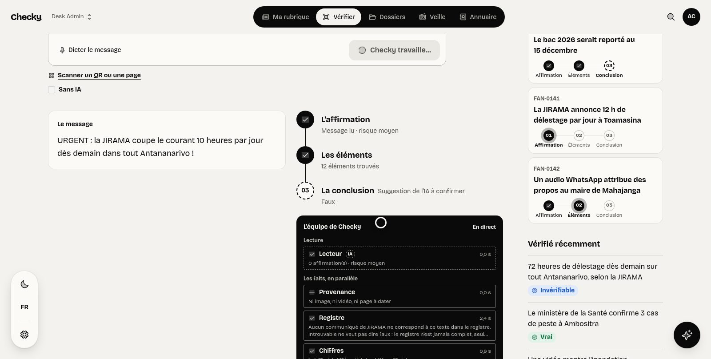
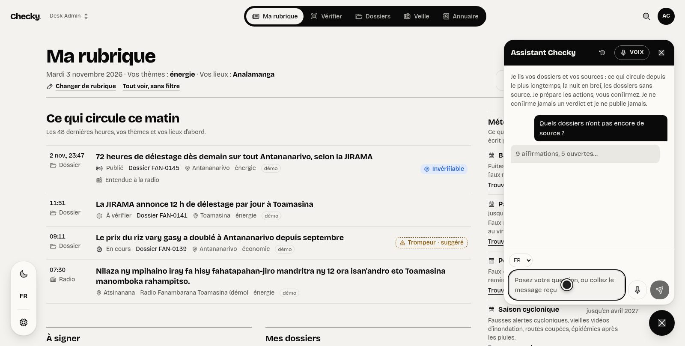
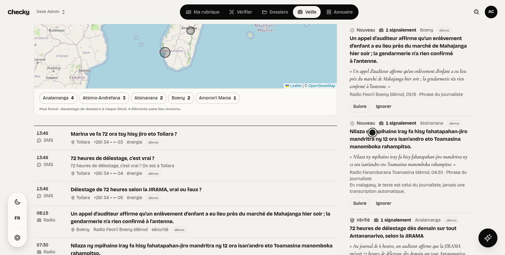
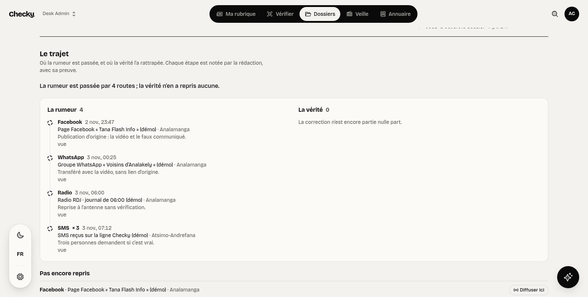
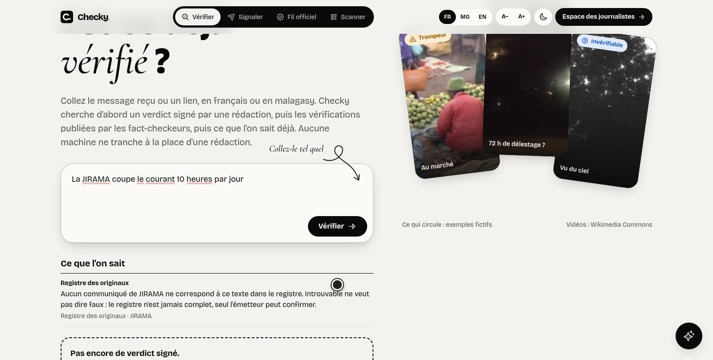
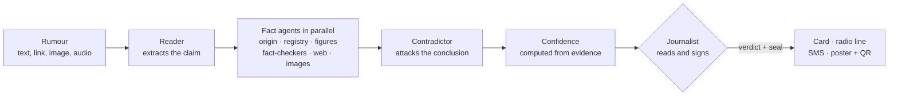
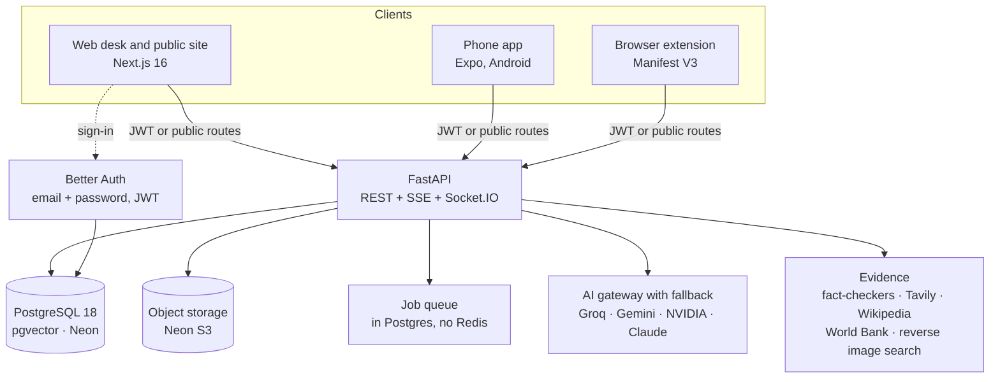

<div align="center">


# Checky

**« La torche des rédactions ».** Verify a rumour, show the proof, send the truth back down the same road.

[](https://github.com/0nlyDevs/checky-platform/actions/workflows/ci.yml)
[](https://checky-mg.vercel.app)


**[Live demo](https://checky-mg.vercel.app)** · **[Phone app](https://github.com/0nlyDevs/checky-mobile)** · **[Browser extension](https://github.com/0nlyDevs/checky-extension)** · **[Development guide](#development-guide)**

</div>

---

## Why Checky

In Madagascar a rumour travels from a Facebook reel to WhatsApp groups, to a regional radio, to an SMS chain in a few hours, and the correction arrives nine hours later, if at all. Journalists need one tool to qualify, check and answer, in Malagasy, French and English, even with a weak connection.

Checky follows a claim from its first appearance to a signed verdict, then sends the answer back along the same road: a WhatsApp card, a radio line, an SMS, a printed poster with a sealed QR code.

> **Knowing is not publishing.** Checky only *suggests* a verdict (dashed outline). A journalist always reads the proof, confirms and signs (solid). Anything public only leaves a newsroom that the Checky team has verified: *everyone can check, only verified newsrooms publish.*



## What it does

| Need | What Checky gives you |
|---|---|
| **Check a claim** | Paste a message, a link, an image, a recording or dictate it. A crew of agents reads it, looks for the first appearance, compares it with official communiqués and figures, fact-checkers and the web, then a contradictor tries to break the conclusion. |
| **Trust level** | A confidence level computed from the evidence found (never by the model), with the facts shown first and the AI reading dashed. « Sans IA » keeps only the facts. |
| **Images and video** | EXIF and metadata, AI-generator traces, C2PA content credentials, reverse-search links, faces blurred by default, voice transcription (Malagasy and French). |
| **National watch** | Map of what circulates by region, radio sentences heard on air grouped by rumour, SMS and tips, watched words, rumour weather, dangerous-rumour alerts. |
| **Directory and figures** | Who to call and *who can prove it*, with the question ready; official documents, a registry of originals with offline seals, dated official figures. |
| **Story angles** | Three to five angles for a topic, each resting on numbered facts. |
| **AI assistant** | On every page: it knows the desk, answers with sources and *proposes* actions that a journalist confirms with a click (or a spoken « oui »). |
| **Sign and send back** | Sign a verdict, then get a square or vertical card, a radio line, an SMS, a printable poster with a sealed QR code, and a PDF due-diligence record. |
| **For everyone** | Public pages with no account: « Est-ce déjà vérifié ? », tips with a follow-up link, the official feed, today's flashes for radios (`/flashs`). |
| **Hard conditions** | Offline queue and cache on the phone, SMS line for basic phones, A−/A+ text size and a low-bandwidth « Mode éco ». |

<table>
  <tr>
    <td width="50%"><br><sub><b>Ma rubrique</b>: what circulates this morning, the rumour weather and the assistant.</sub></td>
    <td width="50%"><br><sub><b>Veille</b>: what circulates by region, radio sentences and SMS.</sub></td>
  </tr>
  <tr>
    <td width="50%"><br><sub><b>Le trajet</b>: the rumour's road, and where the truth has not followed yet.</sub></td>
    <td width="50%"><br><sub><b>Public site</b>: « Est-ce déjà vérifié ? » with no account.</sub></td>
  </tr>
</table>

## How a check works



Four answers only, never a fifth: **Vrai**, **Faux**, **Trompeur**, **Invérifiable**. Each is an icon plus a word, never colour alone. A quote is kept only if it appears word for word in its source.

## Architecture



- **Login** lives in the web app (Better Auth). The browser gets a 15-minute JWT and calls the API with it; the API checks it against the web app's JWKS.
- **One Postgres, two schemas:** `better_auth` (users, sessions) and `app` (everything else, Alembic migrations).
- **Background jobs** run in the API process from a Postgres table claimed with `SELECT … FOR UPDATE SKIP LOCKED`. No Redis.
- **AI gateway** (`apps/api/app/core/ai.py`) falls back from provider to provider, rotates keys when a quota is hit, and logs every call without the prompt text. Agents share one tool loop and guardrails (`apps/api/app/modules/guard.py`); see [`docs/WEB_SEARCH.md`](docs/WEB_SEARCH.md).
- **One kind of account.** Every member of a newsroom can do everything; there are no roles.
- **Pictures leave the desk blurred:** every upload gets a single-frame, EXIF-free copy with faces blurred (OpenCV); only that copy is shown or sent to reverse search.

## Tech stack

| Layer | Technologies |
|---|---|
| **Web frontend** | Next.js 16 (App Router, Turbopack), React 19, TypeScript, Tailwind CSS v4, shadcn/ui, SWR, dnd-kit, Leaflet, html-to-image |
| **Backend** | FastAPI, Python 3.13 (uv), SQLAlchemy 2 (async), Alembic, python-socketio, httpx, pydantic |
| **Database** | PostgreSQL 18 on Neon, pgvector (768-d embeddings, HNSW) for RAG |
| **Auth** | Better Auth (email + password, JWT EdDSA, Expo plugin for the phone app) |
| **Files** | Neon object storage (S3-compatible), presigned uploads |
| **AI** | Groq (gpt-oss-120b, Whisper), Gemini (chat and embeddings), NVIDIA, Claude (optional), ElevenLabs (voice), all behind one gateway |
| **Evidence** | Google Fact Check Tools, Tavily, Wikipedia (fr/mg/en), World Bank, SerpApi / Google Lens |
| **Media** | Pillow, OpenCV (face blur), ffmpeg, pypdf, trafilatura, C2PA |
| **Seals** | Ed25519 signatures and QR codes (segno), checked offline |
| **Mobile** | Expo SDK 58, React Native 0.88, Expo Router |
| **Extension** | Manifest V3, Vite, no runtime framework |
| **Quality** | pytest, ruff, tsc, eslint, GitHub Actions on a pgvector Postgres |
| **Hosting** | Vercel (web), Render (API), Neon (database and storage) |

## The three repositories

| Repository | What it is | Stack |
|---|---|---|
| [**checky-platform**](https://github.com/0nlyDevs/checky-platform) (this one) | Web desk, public site and the API every client talks to | Next.js, FastAPI, PostgreSQL |
| [**checky-mobile**](https://github.com/0nlyDevs/checky-mobile) | Android app: *Share → Checky* from WhatsApp, Facebook or TikTok, offline queue, citizen mode, seal scanner | Expo, React Native |
| [**checky-extension**](https://github.com/0nlyDevs/checky-extension) | Right-click a text, image or link and check it in a side panel, with no account | Manifest V3, Vite |

```
apps/web/         Next.js 16 web app (UI in French, Malagasy and English)
apps/api/         FastAPI API, AI gateway, agents, job queue, migrations
packages/shared/  TypeScript types generated from the API (do not edit by hand)
docs/             PRD, web search setup, image detector, pitch kit, screenshots
```

## Quick start

```bash
gh repo clone 0nlyDevs/checky-platform && cd checky-platform
npm install && (cd apps/api && uv sync)
cp .env.example .env && cp .env apps/web/.env.local    # then fill in .env
(cd apps/api && uv run uvicorn app.main:app --reload --port 8000)   # terminal 1
(cd apps/web && npx next dev -p 3000)                                # terminal 2
```

Open http://localhost:3000, create an account and tick **« Données de démonstration »** to get example rumours, sources and verdicts. API docs: http://localhost:8000/docs. The full setup (databases, environment variables, first migration) is in the [development guide](#development-guide) below.

## More documentation

- [`docs/PRD.md`](docs/PRD.md): what we are building and why
- [`apps/web/DESIGN.md`](apps/web/DESIGN.md) and [`apps/web/PRODUCT.md`](apps/web/PRODUCT.md): design system and product rules
- [`docs/WEB_SEARCH.md`](docs/WEB_SEARCH.md), [`docs/IMAGE_DETECTOR.md`](docs/IMAGE_DETECTOR.md): search and image-detector setup
- [`docs/pitch/README.md`](docs/pitch/README.md): pitch kit
- [`CLAUDE.md`](CLAUDE.md): the full technical reference (architecture, API, status), also read by Claude Code
- [`THIRD_PARTY.md`](THIRD_PARTY.md): licence of every library

## About

Built by team **OnlyDevs** (students at HEI) for the **FANILO Hackathon**, organised by **IFM** and **42** in Antananarivo, 2 to 4 November 2026. Every rumour shown as an example in the app is fictional and labelled.

---

# Development guide

## Set up (about 10 minutes)

### 1. Install the tools

- **Node 26** and **npm** (npm only: never `pnpm`, `yarn` or `bun` in this repo)
- **[uv](https://docs.astral.sh/uv/)** for Python (it installs Python 3.13 for you)
- **PostgreSQL 17 or 18**, running locally
- **ffmpeg** (reads the soundtrack and tags of uploaded videos; without it only mp4/webm videos
  are transcribed, sent whole to Whisper). The API's Docker image needs it too.
- `git`, and the [GitHub CLI](https://cli.github.com/) (`gh auth login`) to clone the private repo

### 2. Clone and install

```bash
gh repo clone 0nlyDevs/checky-platform
cd checky-platform
npm install                       # web + shared packages
cd apps/api && uv sync && cd ../..  # API (creates apps/api/.venv)
```

### 3. Create the databases

```bash
createdb -U postgres fanilo        # the app
createdb -U postgres fanilo_test   # used by the API tests (wiped after each test)
```

### 4. Environment files

There are two, with the same content:

| File | Read by |
|---|---|
| `.env` (repo root) | the API |
| `apps/web/.env.local` | the web app |

Both are gitignored. **Never commit them.**

```bash
cp .env.example .env
# edit .env (see the table below), then:
cp .env apps/web/.env.local
```

| Variable | Local value | Where it comes from |
|---|---|---|
| `DATABASE_URL` | `postgresql://postgres:<your password>@localhost:5432/fanilo` | your local Postgres |
| `BETTER_AUTH_SECRET` | any random string | `openssl rand -base64 32` |
| `BETTER_AUTH_URL` | `http://localhost:3000` | where the web app runs |
| `NEXT_PUBLIC_API_URL` | `http://localhost:8000` | where the API runs |
| `AUTH_JWKS_URL`, `AUTH_ISSUER`, `AUTH_AUDIENCE`, `CORS_ORIGINS` | keep the example values | must point to the web app's address |
| `PLATFORM_ADMINS` | your own user id, to review newsroom requests | `GET /api/v1/me` → `id` once you have signed up (Better Auth user ids, comma-separated) |
| `STORAGE_ENDPOINT`, `STORAGE_REGION` | branch storage endpoint, `eu-central-1` | Neon console → project `fanilo` → Object storage → Connect |
| `STORAGE_ACCESS_KEY_ID`, `STORAGE_SECRET_ACCESS_KEY` | secret (`nak_…` / `nsk_…`) | same panel → Reveal credential |
| `STORAGE_BUCKET` | `uploads-dev` | `uploads` is the production bucket |
| `GROQ_API_KEY` | secret | [console.groq.com](https://console.groq.com/keys) |
| `GEMINI_API_KEY` | secret | [aistudio.google.com](https://aistudio.google.com/apikey) |
| `NVIDIA_API_KEY` | secret | [build.nvidia.com](https://build.nvidia.com/) |
| `CLAUDE_API_KEY` | secret, optional and paid; empty = Claude is skipped | [console.anthropic.com](https://console.anthropic.com/) |
| `ELEVENLABS_API_KEY` | secret, optional (the assistant's voice; without it the browser reads) | [elevenlabs.io](https://elevenlabs.io/app/settings/api-keys) |
| `GOOGLE_FACTCHECK_API_KEY` | optional: claim reviews from fact-checkers worldwide | a Google Cloud key with the Fact Check Tools API enabled |
| `LLM_MODEL_*` | empty = gateway default | set once we have picked models |
| `LLM_PROVIDERS` | `groq,gemini,nvidia,claude` | the order is the fallback order; put `claude` first to prefer it |
| `SEAL_SECRET` | any random string | `openssl rand -base64 32`; seals verdicts and communiqués (without it sealing answers 503) |
| `PUBLIC_WEB_URL` | `http://localhost:3000` | the public site, written into QR codes and `/v/<n>` short links |
| `SMS_GATEWAY_SECRET` | any random string | shared with the SMS gateway phone |
| `SMS_GATEWAY_URL` | optional Android phone gateway API base URL | the phone's LAN address or its gateway relay URL |
| `SMS_GATEWAY_USER`, `SMS_GATEWAY_PASSWORD` | optional basic-auth credentials | the gateway app's API settings |
| `SMS_GATEWAY_TOKEN` | optional bearer token instead of basic auth | the gateway app's API settings |
| `SMS_GATEWAY_SIGNING_KEY` | optional webhook HMAC key | the gateway app's webhook settings |
| `SMS_GATEWAY_SIM` | `0` for the phone's default SIM | choose `1`–`3` for a specific SIM |

Several teammates' keys can share one variable: `GROQ_API_KEY=gsk_a,gsk_b` (one free account each;
several accounts per person usually breaks the providers' terms).
| `AI_CACHE` | `true` | caches identical AI requests on disk so reloads don't burn quota |

If you run the web app on a port other than 3000, change it in **all** of `BETTER_AUTH_URL`,
`AUTH_JWKS_URL`, `AUTH_ISSUER`, `AUTH_AUDIENCE` and `CORS_ORIGINS`.

### 5. Create the tables

```bash
psql -U postgres -d fanilo -c "CREATE SCHEMA IF NOT EXISTS better_auth"
cd apps/web && set -a && . ./.env.local && set +a && npx @better-auth/cli@latest migrate --config lib/auth.ts --yes && cd ../..
cd apps/api && uv run alembic upgrade head && cd ../..
```

(On fish shell, run the Better Auth line from bash: `bash -c '…'`.)

### 6. Run

Two terminals:

```bash
cd apps/api && uv run uvicorn app.main:app --reload --port 8000
cd apps/web && npx next dev -p 3000
```

Open http://localhost:3000, create an account, and create a workspace with
**"Données de démonstration"** ticked (the default) to get 8 example claims. API docs: http://localhost:8000/docs.

### SMS gateway phone

Install an Android SMS gateway app that supports the `POST /messages` API and `sms:received`,
`sms:sent`, `sms:delivered`, and `sms:failed` webhooks (the adapter currently speaks the
SMS Gateway for Android format). Put a local SIM in the phone, enable its API, and set
`SMS_GATEWAY_URL` and either the basic-auth credentials or bearer token above. Point each of its
four webhooks to `https://<API-address>/api/v1/public/sms/gateway` (the app requires HTTPS,
except for a localhost development bridge). Set the same signing key in the app and
`SMS_GATEWAY_SIGNING_KEY`; if the app cannot sign, append `?secret=<SMS_GATEWAY_SECRET>` to the
webhook URL. The API accepts inbound SMS through that webhook and pushes queued replies through
its Postgres worker, retrying temporary failures. The SMS simulator in Réglages exercises the
same message handling without a phone. With `SMS_GATEWAY_URL` empty, the authenticated polling
outbox remains available to another gateway.

In **Vérifier → Avant l'antenne**, paste a caller's claim or dictate it in French. The signed
verdicts of public newsrooms appear first, with a two-sentence radio line and the verification
number. A Malagasy radio line appears only after a journalist has reread and attested it;
Malagasy input can be typed. Fact-checkers' published reviews follow under their own names.

### Alert kit

In **Veille → Alertes**, open a high-risk alert and prepare its kit from the reports already
attached to it. The draft is dashed until a journalist reviews and approves it. The call list
uses only contacts belonging to that newsroom, even when another newsroom has shared a contact
in the directory. The Malagasy radio script is held until a journalist marks its exact text
as reread. Sending to the desk creates a live notice; partner radios with an SMS number enter
the existing gateway outbox, and fictional demo numbers are simulated. WhatsApp remains a link
the journalist opens manually. Radio numbers are masked in the desk's SMS list, and the short
WhatsApp link in the kit response hides the number and expires after ten minutes. A journalist
may close an alert only with a reason; a published verdict on a linked case also closes it.

`/flashes` serves today's signed verdicts as a printable, script-free HTML page under 20 KB,
with French and Malagasy radio lines and an English interface option. A partner radio's link
keeps its one-tap « Diffusé » form; a recorded newsroom voice note is linked when available.
The line uses the same verification number as the card, SMS and short link. No operator SMS or
voice-line provider is configured by this application.

## Everyday commands

Run these before pushing. CI runs the same checks and fails otherwise.

```bash
# API
cd apps/api
uv run ruff check . && uv run ruff format --check . && uv run pytest -q && uv run alembic check

# Web
cd apps/web
npx next typegen && npx tsc --noEmit && npx eslint .
```

| When you… | Run | Then commit |
|---|---|---|
| change an API route or its models | `npm run gen:api` (API must be importable, not running) | `packages/shared/` |
| add or remove a dependency (npm or uv) | `npm run third-party` | `THIRD_PARTY.md` (required by the hackathon rules) |
| change a table in `apps/api/app/core/models.py` | `cd apps/api && uv run alembic revision --autogenerate -m "what changed"` then `uv run alembic upgrade head` | the new file in `alembic/versions/` |
| add a page in `apps/web/app` | `npx next typegen` | nothing extra |
| auto-format Python | `cd apps/api && uv run ruff format .` | |
| need realistic newsrooms to show | `cd apps/api && uv run python scripts/seed_newsrooms.py --web http://localhost:3000` (web and API running; `--reset` rebuilds them; see the script's header) | nothing: the passwords go to `~/checky-seed-accounts.txt` |

## Git workflow

- Work on **`dev`** (the default branch). `main` is the release branch; ask before pushing to it.
- Commit messages: [Conventional Commits](https://www.conventionalcommits.org/), in English, one
  line. Examples: `feat(api): add source upload`, `fix(web): keep board filters on reload`.
- Pull before you start (`git pull --rebase`). There is no branch protection, so a broken push
  breaks everyone: run the checks first.

## Adding a feature (recipes)

Code, comments and commits are in **English**; everything the user sees is in **French**.

### A new field on a claim

Claims are rows in `app.item` with a free JSON `data` column, so **no migration is needed**.
Send the field in `data` on create or `PATCH /workspaces/{ws}/items/{id}`; it is merged into the
existing data. Fields in use: `ref`, `first_seen_at`, `origin`, `verdict`, `verdict_suggested`,
`source_count`, `assignee_id`, `demo`.

### A new API route

1. Add a function to a module in `apps/api/app/modules/` (or a new module, then
   `api.include_router(...)` in `apps/api/app/main.py`).
2. Protect workspace routes with `AnyMember` from `app/core/access.py` (every member of a
   newsroom may do everything; there are no roles). Outsiders automatically get a 404. Anything
   that reaches the public must check `Workspace.publishes` (opted in and verified by Checky).
3. Raise errors with `ApiError(status, "code", "message")` so they leave as
   `{"error": {"code", "message"}}`.
4. Add a test in `apps/api/tests/` (`as_user("alice")` gives a logged-in client).
5. `npm run gen:api` so the web gets the new types.

### Calling the AI

```python
from app.core import ai

reply = await ai.complete(
    [{"role": "system", "content": "…"}, {"role": "user", "content": claim_text}],
    workspace_id=member.workspace_id,
    temperature=0.2,
)
reply.content, reply.provider
```

To give an agent a new tool, write `async def tool(ctx, **args) -> (summary, result)` and add it
to the agent's tool table (`TOOLS` in `agent.py`, `COPILOT_TOOLS` in `copilot.py`); a tool that
changes something only *proposes* it with `ctx.propose(...)`, and the person confirms it in the
widget. Run the loop with `guard=` so the answer is checked against what the tools returned.

For streaming to the browser, use `POST /api/v1/workspaces/{ws}/ai/stream` (Server-Sent Events:
`delta` events with `{text}`, then `done`). The AI only **suggests** a verdict
(`data.verdict_suggested`); a journalist always confirms it.

### Files and sources

Uploads never pass through the API: `lib/upload.ts` asks `…/files/upload-url` for a presigned
URL, PUTs the file to Neon storage, then calls `…/files/{id}/complete`, which creates a source and
queues `ingest_file`. In the UI, drop `<SourcesPanel ws={ws} itemId={id} />` anywhere to get
add-link, upload and the live list. Server side, read a file with `storage.read(key)`.
Videos (`mp4`, `webm`, `quicktime`, `3gpp`) become `video` sources: ffmpeg pulls out the soundtrack
for Whisper and `ffprobe` reads the tags, which are scanned for AI generators (Sora, Veo…).
Images and 4–6 keyframes per video also get a face-blurred safe copy; a failed transcription keeps
the video ready with its keyframes (re-run it with « Transcrire »). Deleting a source deletes its
frames and copies.
`PATCH …/sources/{id} {item_id}` attaches a source to a claim later; `link-check {source_id}`
checks an uploaded file on its transcript (the phone app's share flow).

### A slow task (transcription, ingestion…)

```python
from app.workers.queue import handler, JobContext, enqueue

@handler("my_task")
async def my_task(ctx: JobContext) -> dict:
    await ctx.progress(50)          # pushed live to the browser as job.progress
    return {"result": "…"}

job = await enqueue(db, member.workspace_id, member.user.id, "my_task", {"item_id": "…"})
```

The browser follows it with Socket.IO events `job.progress` / `job.done` / `job.failed`, or
`GET /workspaces/{ws}/jobs/{id}`. Failed jobs can be retried.

### A new screen

1. Add a route under `apps/web/app/(app)/w/[ws]/…/page.tsx`, then `npx next typegen`.
2. Fetch data with SWR and `api()` from `lib/api.ts` (it adds the token); see
   `components/claims/claims-view.tsx`.
3. Live updates: `useWorkspaceSocket(workspaceId, { "item.updated": … })` from
   `hooks/use-workspace-socket.ts`.
4. **Every** user-visible string goes in `apps/web/lib/i18n/fr.ts`.
5. Follow `apps/web/DESIGN.md` (one world, « Le signal clair », for the desk and the public pages).
   The rules that must not break:
   - citron `#d7f45b` only for the one action of a screen (`<Button variant="action">`), the active
     step and highlights; never a verdict, a status or decoration;
   - a verdict is always **icon + label**, never colour alone; an AI suggestion is a dashed outline,
     a confirmed verdict is solid;
   - status icons never use verdict colours;
   - reuse the numbered line (`components/flow/step-line.tsx`) wherever a rumour's progress shows.
6. The public, no-account pages live in `apps/web/app/(site)/` (`/`, `/verdicts`, `/report`,
   `/track/[token]`, API `/api/v1/public/*`, only for newsrooms that opted in). Every rumour shown as
   an example on them is fictional and labelled.

Next.js 16 is newer than most tutorials and AI training data: read
`apps/web/node_modules/next/dist/docs/` before using an unfamiliar API.

## Troubleshooting

| Problem | Fix |
|---|---|
| The page reloads in a loop after a crash | stop the web server, `rm -rf apps/web/.next`, start again |
| Login works but every API call is 401 | the web address differs from `AUTH_ISSUER` / `AUTH_AUDIENCE` / `AUTH_JWKS_URL` in `.env` |
| CORS error in the browser | add the web address to `CORS_ORIGINS` and restart the API |
| `relation "user" does not exist` | the `better_auth` schema or its tables are missing: redo step 5 |
| Not sure which service is down | open **Réglages** in the app (or `GET /api/v1/health`): database, storage and each AI provider, with the missing env variable named |
| AI routes return 503 `ai_unavailable` | no AI key in `.env`, or every provider failed (see `app.ai_call`) |
| `npm` warns it blocked an install script | harmless |

## Deployment

The web app runs on Vercel (Root Directory `apps/web`, production branch `dev`), the API on
Render from [`render.yaml`](render.yaml) (it deploys `dev` once CI is green and migrates the
database in its build), and the database and file storage on Neon. Account details, connection
strings and keys are not kept in this repository: ask the team.

